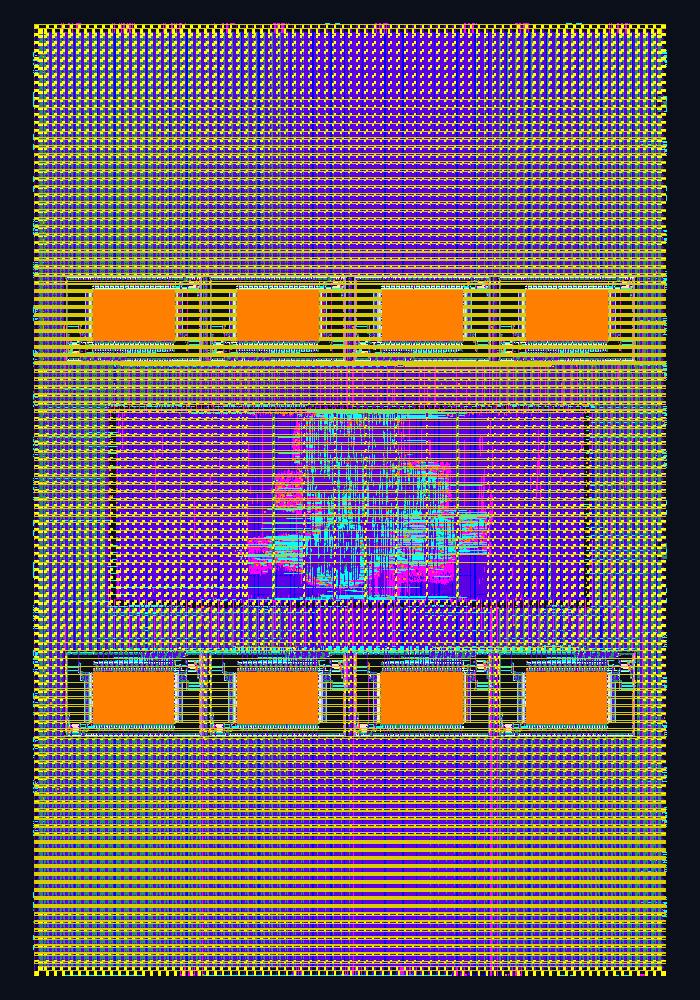
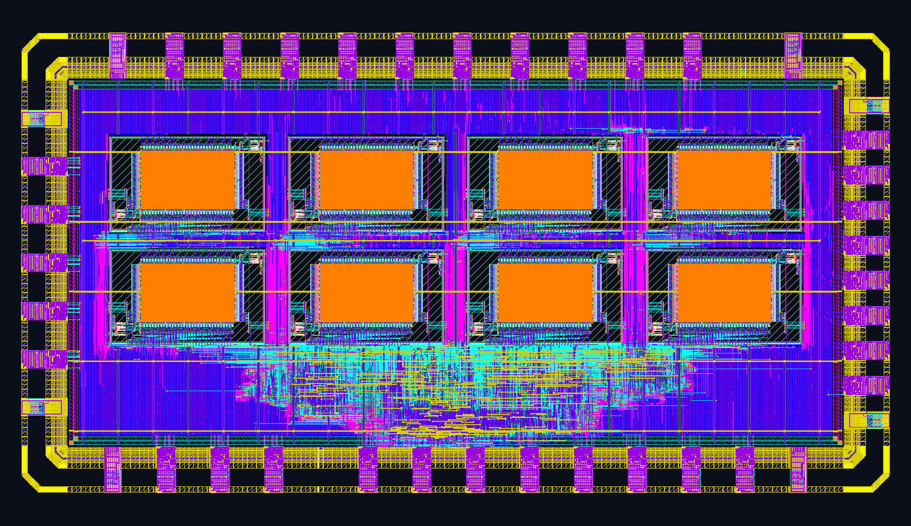
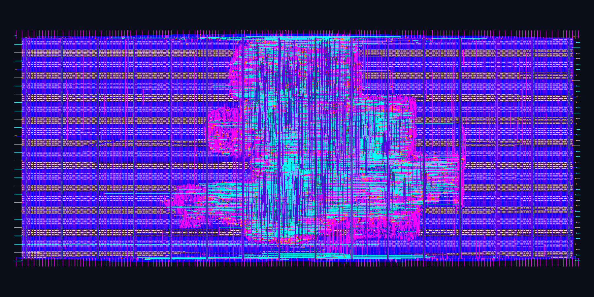
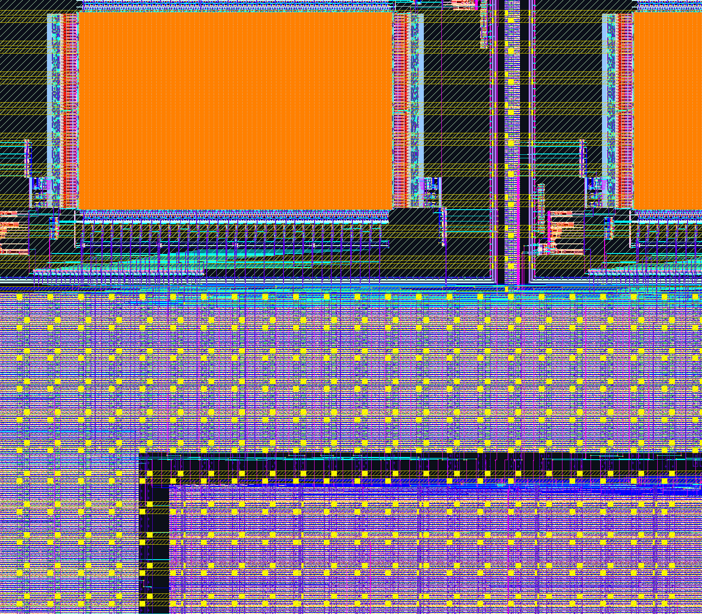

# SKY130A RISC-V 低功耗传感器 SoC — 物理实现与签核基线

[English README](README_EN.md)

> 全开源工具链（Yosys/slang → LibreLane/OpenROAD → KLayout/Magic/Netgen/CVC）完成 RTL-to-GDSII 全流程；
> 官方 `cf-precheck` 核心签核项（XOR / LVS / OEB / 布线 DRC / 几何规则）全部通过，3 项全规则检查为已逐条归属的硬 IP 内部豁免项。

本项目是一套面向**定制传感器接口、工业边缘控制与科研载荷**的 32 位 RISC-V（`RV32IMC`）低功耗 SoC 物理实现基线，基于 SkyWater **SKY130A** 工艺，同时完成 **MPW 拼板（ChipFoundry OpenFrame）** 与 **自立式裸片（自建 Pad-ring）** 两种交付形态。

---

## 版图概览

| OpenFrame 顶层 `openframe_project_wrapper`（3166 × 4766 µm） | 自立式裸片 `chip_top`（3800 × 2016 µm） |
| :---: | :---: |
|  |  |
| 15.09 mm² · 硬化逻辑宏 + 8×2KB SRAM + 44 GPIO | 7.66 mm² · 34×`gpiov2` + 8×电源焊盘 + 8×2KB SRAM |

| 硬化逻辑宏 `soc_of_logic`（2400 × 1000 µm） | SRAM 与顶层 `met4/met5` 电源网格局部 |
| :---: | :---: |
|  |  |
| 限 `met1–4` 独立签核，DRC/LVS/天线全 0 | 8 块 SRAM 电源环经 119 条 `met5` 贯通供电 |

---

## 签核指标

| 检查项 | OpenFrame（`soc_of_w10`） | Standalone（`chip_r7_eco`） |
|---|---|---|
| 详细布线 DRC | **0**（6 轮收敛） | **0**（17 轮收敛） |
| Netgen LVS | **`Circuits match uniquely`**，0 引脚失配 | **`Circuits match uniquely`**，0 引脚失配 |
| GDS 布尔异或（XOR） | **0 差异**（对官方 golden 模板） | **0 差异**（DEF ↔ GDS） |
| CVC / OEB 电学规则 | **0 error**（44 GPIO 配置全部正确识别） | 不适用（自建焊盘环） |
| 时序（tt 三角 @ 16 MHz） | setup / hold **0 / 0** | setup / hold **0 / 0** |
| PDN 连通性 | 探针至 119 条 `met5` 全通，0 开路 / 0 短路 | 64 个 SRAM 电源脚 100% 搭接，IR drop ≤ 13.5 µV |
| 天线 | 逻辑宏 0；SRAM 256 根输出线 0；wrapper 残余 18 处（pad 边界已知项） | 0 违例网（2161 个保护二极管） |
| 总功耗估算 | 19.5 mW（无向量默认活动率口径） | 4.47 mW（同口径） |
| 官方全规则 KLayout | FEOL 3 / BEOL 264 / 密度 204 处——**全部位于 OpenRAM 硬宏内部**，按 IP 豁免申报 | — |
| `cf-precheck` 快速几何项 | offgrid / zeroarea / spike / pin_label / topcell 全 PASS | 不适用 |

---

## 工程要点

**架构与低功耗**
- Ibex RV32IMC + AHB-Lite/APB 外设集（SPI-NOR 启动、I²C、双 UART、GPIO、64 位定时器）+ RISC-V Debug Module（JTAG、SBA、跨深睡调试）；
- 三异步时钟域（16 MHz 主时钟 / 32.768 kHz 常开域 / JTAG TCK）经专用 CDC 收敛；PMU 检测外设空闲后门控主时钟树，支持 RTC 闹钟、UART1 RX、JTAG 三路异步唤醒；深睡静态漏电地板约 145 µW；
- Verilator + C 固件自动化回归：T1（冷启动 + 全外设 + 深睡唤醒 + WDT 复位恢复）、T2（NOR 镜像异常保护）、T3（JTAG 跨深睡调试）。

**物理实现**
- 分层硬化方案：逻辑宏 `soc_of_logic` 限 `met1–4` 独立签核；8 块 OpenRAM SRAM 置于顶层，由 `met4/met5` 电源网格直连供电——规避子宏布线层限制与 SRAM 电源环供电需求之间的冲突，连通性经 KLayout `LayoutToNetlist` 全网追踪验证；
- `LVS_FLATTEN` 处理边界电源连接宏（`vccd1_connection`/`vssd1_connection`），官方 LVS 实现零引脚失配；
- 全 GDS 展平 DRC 的 cell 级归属分析：471 处违例逐条定位至 SRAM 硬宏内部 cell，用户逻辑与布线区 0 违例（详见签核证据文档）。

---

## 文档导航

- [架构规格书：微架构、地址映射、时钟复位与验证矩阵](docs/01_Architecture_Spec.md)
- [物理签核证据包：Precheck 逐项核验、工程难题记录、DRC 归属分析](docs/02_Physical_Signoff_Evidence.md)
- 技术专栏
  - [`cf-precheck` 检查机制与裸片适用性](docs/tech_notes/precheck说明.md)
  - [LibreLane 时钟树综合（TritonCTS）与 clock skew](docs/tech_notes/librelane的cts.md)
  - [OpenSTA slack 计算原理与多角签核口径](docs/tech_notes/slack计算原理.md)
  - [Die 形状成因与封装路径（QFN / COB / chipIgnite 交付形态）](docs/tech_notes/die_shape_and_packaging.md)
- [RTL 示例：`apb_uart.sv`（带深睡忙互锁与帧错误恢复的 APB UART）](rtl_sample/apb_uart.sv)

---

## 合作与服务

面向**高校课题组、初创芯片团队与工业传感器厂商**提供以下服务：

1. **科研流片载具**：在本基线 SoC 上集成您的专用模块（传感器 AFE、存算/加速核、安全引擎等），交付可投片的 SKY130 / GF180 GDS 与测试固件；
2. **联合投片**：开放本 SoC 剩余逻辑面积与总线接口，与有 MPW 计划的团队合流，分摊或互换流片资源；
3. **物理后端代工与签核通关**：承接 RTL-to-GDSII 实现，专项处理多宏 floorplan、PDN 连通性、天线/hold 违例、LVS 失配与 `cf-precheck` 卡关；
4. **定制 ASIC 原型**：从规格、RTL、验证到 MPW 投片与 bring-up 的全流程交付。

---

### 联系

- 邮箱：`hebin_21cn@foxmail.com`
- 微信：`BILLULM`

> 本仓库仅公开架构规格、示例模块与脱敏签核证据。完整 RTL、物理实现配置（`config.json` / `pdn.tcl` / `lvs_config.json`）与 GDS 数据库面向合作方开放。

### 许可

- 代码（`rtl_sample/` 等）：[Apache-2.0](LICENSE)
- 文档与图片（`README.md`、`docs/`、`assets/`）：[CC BY 4.0](LICENSE)
